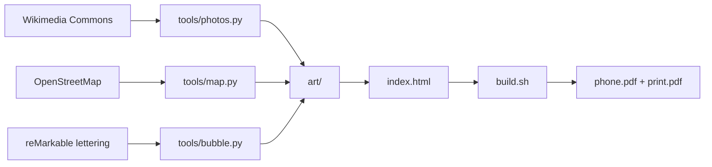

```
 ███╗   ███╗ █████╗ ██████╗ ██████╗ ██╗██████╗
 ████╗ ████║██╔══██╗██╔══██╗██╔══██╗██║██╔══██╗
 ██╔████╔██║███████║██║  ██║██████╔╝██║██║  ██║
 ██║╚██╔╝██║██╔══██║██║  ██║██╔══██╗██║██║  ██║
 ██║ ╚═╝ ██║██║  ██║██████╔╝██║  ██║██║██████╔╝
 ╚═╝     ╚═╝╚═╝  ╚═╝╚═════╝ ╚═╝  ╚═╝╚═╝╚═════╝
```

<div align="center">

### `¡MADRID! // A COMIC GUIDE FOR IB2`

*a 12-page A5 trip brochure, written in HTML and printed by a headless browser*

    

</div>

---

## 🗺️ What is this

The brochure my class takes on the IB2 trip to Madrid (26-29 Nov 2026), made as a CAS creativity project. It is one `index.html` styled like a Spanish tebeo comic: Comic Neue body text, Bowlby One headlines, real photos in thick ink frames, a hand-drawn map, and a cover bubble I lettered myself on a reMarkable.

Every fact in it is listed in [SOURCES.md](SOURCES.md) with a link. Where sources disagree the claim is marked CHECK, and stories with no proof (why Madrileños are called "gatos") are marked LEGEND and told as stories. Botín being the oldest restaurant in the world is Guinness's opinion, and the page says so.

```console
nick@madrid-brochure:~$ ./build.sh
[✓] built phone.pdf and print.pdf
[i] pages overflowing: 0. the Prado page fits. barely.
```

## 📖 The pages

| | page | what it actually holds |
|---|---|---|
| 01 | **cover** | a photo turned into comic art, with a speech bubble in my handwriting |
| 02 | **madrid by the numbers** | altitude, km 0, metro, population, 15 european cups |
| 03-04 | **1,100 years of madrid** | mayrit to now, in square history panels |
| 05 | **where everything is** | a map drawn from openstreetmap data, not a screenshot of one |
| 06 | **prado hunt** | paintings to find, by room |
| 07-08 | **go see** | the sights, each with a credited photo |
| 09 | **eat and drink** | what to order and where |
| 10 | **day trip: toledo** | the one day out of the city |
| 11 | **survival kit** | the practical page (read this one) |
| 12 | **did you spot it?** | answers to the hunts |

## 🚀 Run it

Needs [uv](https://docs.astral.sh/uv/) for the tools and Playwright's headless Chromium for the build (`bunx playwright install chromium-headless-shell`). The build script finds it under `~/Library/Caches`, so it is macOS only as written.

```bash
git clone https://github.com/nitrimandylis/madrid-brochure.git
cd madrid-brochure
open index.html        # read it in a browser
./build.sh             # phone.pdf (pages in order) + print.pdf (booklet sheets)
```

Print `print.pdf` double-sided, flip on the short edge, fold, staple.

## 🔩 Under the hood



| file | job |
|---|---|
| `index.html` | the whole brochure: every page, all the CSS, `?booklet` for print order |
| `build.sh` | prints both PDFs with headless Chromium and counts pages that overflow |
| `SOURCES.md` | every fact and the link it came from |
| `tools/photos.py` | downloads and crops each photo from Commons, records author and licence in `photos.json` |
| `tools/map.py` | draws the central Madrid map from OpenStreetMap data |
| `tools/comic.py` | turns the cover photo into flat colours, ink outlines and halftone dots |
| `tools/bubble.py` | prints empty bubbles to letter on the reMarkable, then puts the chosen one on the cover |
| `tools/fetch_refs.py` | finds reference images on Commons and saves them with their licence |

**Stack:** HTML · CSS · Python (uv scripts, Pillow) · headless Chromium

---

<div align="center">

**[Nick Trimandylis](https://github.com/nitrimandylis)**

`DO NOT ASK FOR DINNER BEFORE 21:00`

Code MIT licensed, see [LICENSE](LICENSE). Photos keep their own licences (public domain, CC BY, CC BY-SA), credited on the page and in `tools/photos.json`. Map data © OpenStreetMap contributors (ODbL).

</div>
